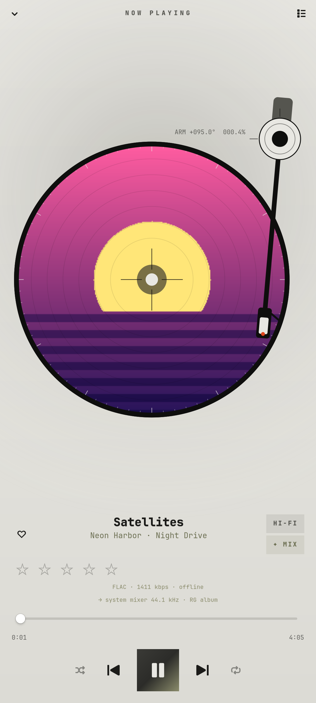
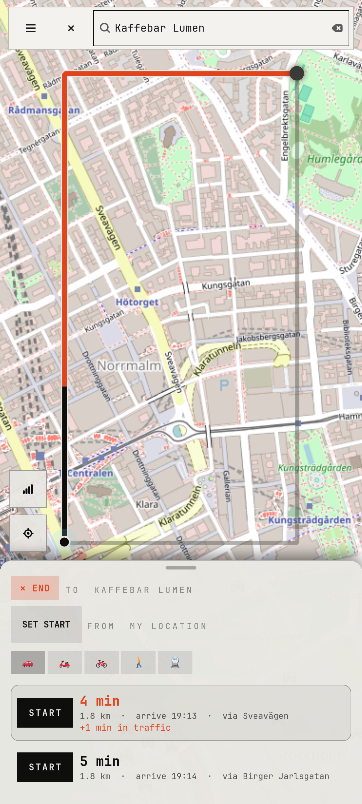
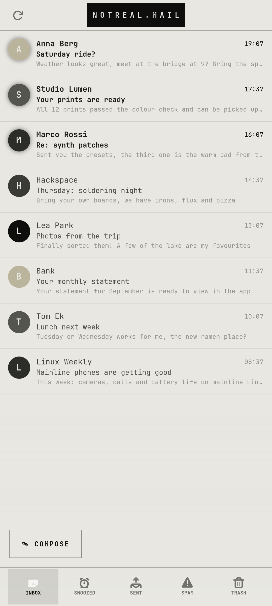
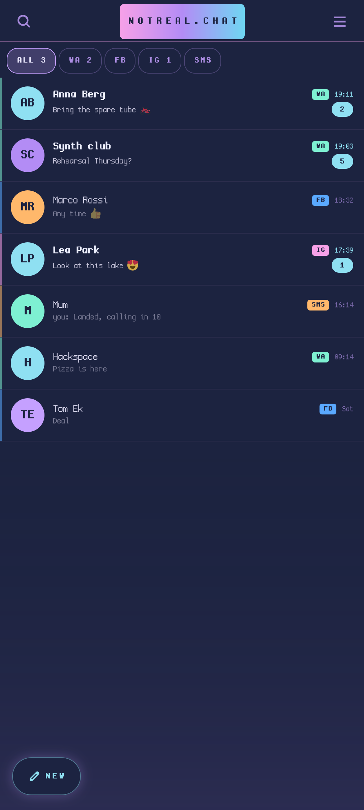
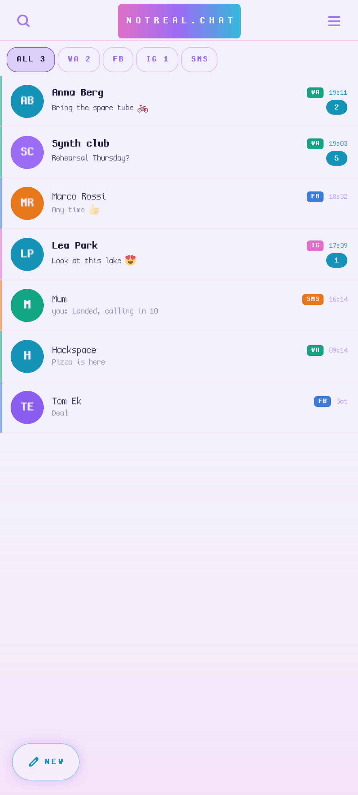
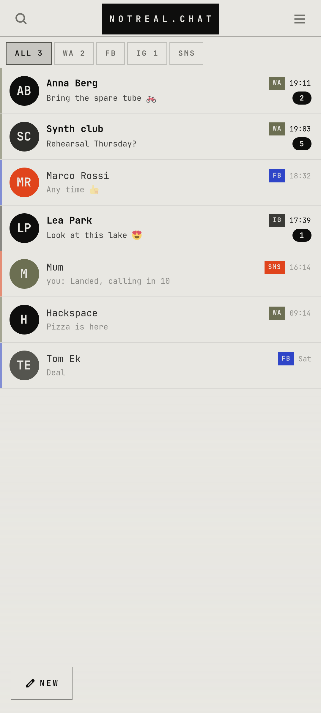
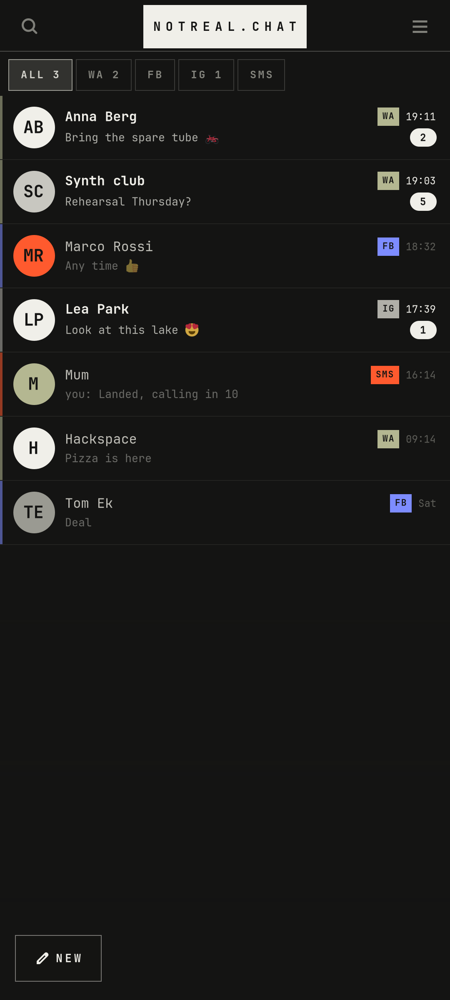
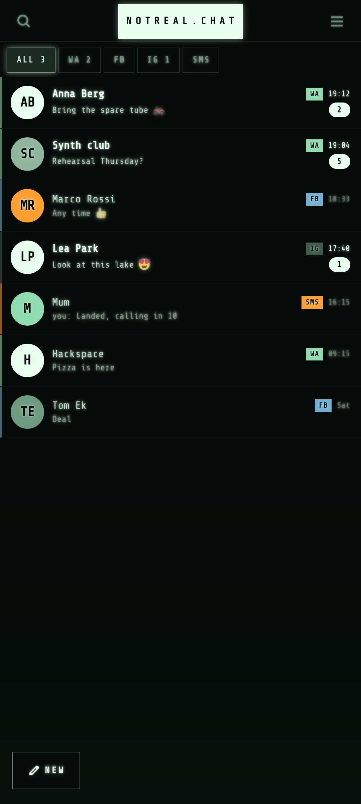
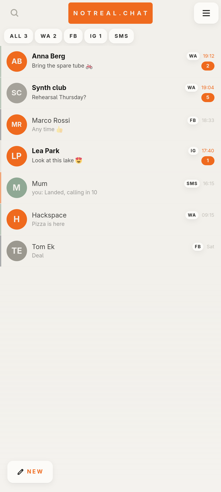

# notreal.OS

A phone made from scratch on top of mainline Linux, running on a **Nothing Phone (1)**
("Spacewar", Snapdragon 778G+) with postmarketOS and Phosh.

The apps, the shell and the hardware fixes in this repo were built together with
[Claude Code](https://claude.com/claude-code), on the phone itself, in about ten days.

> **Experimental.** This is one person's daily phone, not a finished distribution.
> Expect rough edges, and don't flash anything you can't restore.

<p>




</p>

*All screenshots are taken in a sandbox with made-up data ([tools/shots](tools/shots)).*

## Apps

All apps are Python + GTK4/libadwaita, sized for a phone, with the main controls on the left
(the author is left-handed).

| App | What it does |
| --- | --- |
| [notreal.cam](apps/notreal.cam) | 12 MP photos, tap to focus, lens switch, FILM mode, video |
| [notreal.mail](apps/notreal.mail) | Swipeable mail for Gmail and Microsoft 365, spam/trash tabs, notifications |
| [notreal.chat](apps/notreal.chat) | Chats over Matrix bridges (WhatsApp, Messenger, Instagram) and SMS, voice messages, GIFs |
| [notreal.phone](apps/notreal.phone) | Dialer, recent calls and the call screen (GNOME Calls as the engine) |
| [notreal.calendar](apps/notreal.calendar) | Google, Outlook and Microsoft 365 calendars via Evolution Data Server |
| [notreal.contacts](apps/notreal.contacts) | Google contacts: call, message, WhatsApp, mail |
| [notreal.gallery](apps/notreal.gallery) | Photos, with Google Photos backup and import |
| [notreal.edit](apps/notreal.edit) | Crop, curves and saturation, save a copy or share |
| [notreal.link](apps/notreal.link) | Light web viewer for links opened from chat and mail |
| [notreal.share](apps/notreal.share) | Send files to a chat or a new mail |
| [notreal.sound](apps/notreal.sound) | Separate media and notification volume |
| [notreal.player](apps/notreal.player) | Navidrome music client with a spinning vinyl (or a cassette), animated covers, bit-perfect USB DAC output, offline songs |
| [notreal.maps](apps/notreal.maps) | Google maps, places and routes with GPS and offline voice navigation |
| [notreal.feed](apps/notreal.feed) | Reader for Reddit through a self-hosted Redlib on the PC (not affiliated with Reddit) |

## The shell

The Phosh app grid is replaced by a **joystick**: hold it and your most-used apps fan out under
your thumb. Above it, a **widget** shows weather, battery and RAM, the phone's health, what's
playing and your agenda. Swipe up from the left edge for **search, reminders and notes**:
reminders wake the phone from sleep and are read aloud. Hold volume up to just say it instead.

<p>


</p>

*Real screenshots from the phone, personal details blacked out.* More in [shell/](shell).

## Themes

One switch restyles the whole phone: every app, the wallpaper, the widget, the joystick, the
keyboard, the Phosh top bar and lock screen, and the icons. Pick one from the ◐ button on the
overview widget, or run `nrtheme <name>`.

<p>






</p>

*vapor · vaporlight · micro · microdark · alien · nasa.* Details: [shell/theme](shell/theme).

## Layout

```
apps/            the apps above
shell/           joystick launcher, swipe keyboard, gestures, CRT screen animation, themes
system/          voice assistant, alarms, sleep, health check, backup, haptics, Glyph
spacewar-fixes/  Nothing Phone (1) device tree, drivers, libcamera, audio, calls, sleep
pc/              the home PC side: AI gateway, voices, Matrix bridges, music, feed proxy
docs/            how it all fits together
tools/           stage.py (copy sources in), scan.py (privacy check, also a pre-commit hook)
```

## The PC behind the phone

Some features run on a home PC that the phone reaches over [Tailscale](https://tailscale.com):
the Matrix server and bridges for chat, the Navidrome music server, the local LLM and speech
voices for the voice assistant, the Reddit proxy and nightly backups. Set your PC's address in
`~/.config/notreal/pc.json`:

```json
{ "host": "100.x.y.z", "matrix": "https://your-pc.your-tailnet.ts.net" }
```

How it all connects: [docs/pc-link.md](docs/pc-link.md). PC setup: [pc/README.md](pc/README.md).

## Contributing

Before every commit, `tools/scan.py` checks for IP addresses, hostnames, phone numbers, email
addresses and API keys. Enable the hook with:

```sh
git config core.hooksPath .githooks
```

## Licence

[GPL-3.0-or-later](LICENSE).
