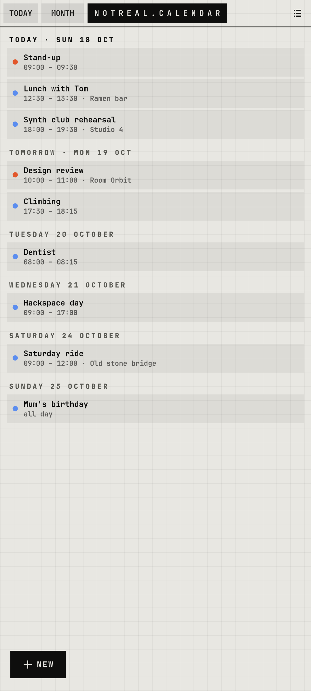

# notreal.calendar

Google, Outlook and Microsoft 365 calendars in one app.

<p></p>

## Features

- AGENDA (upcoming by day) and MONTH views
- New event in big full-screen steps: WHAT → WHEN → WHICH CALENDAR → WHERE / NOTES
- TODAY, month arrows and NEW on the left (left-handed)
- Data through Evolution Data Server, which syncs changes back to Google / Outlook

## Run

```sh
cp -r apps/notreal.calendar ~/calendar    # the code expects to live here
~/calendar/nrcalendar
```

Needs Python 3, PyGObject, GTK 4, libadwaita and the [theme](../../shell/theme) module on `PYTHONPATH` (or `notareal_theme.py` symlinked into `~/.local/lib/python3.*/site-packages/`).

## Needs

evolution-data-server (+ evolution-ews for Microsoft 365), GNOME Online Accounts
