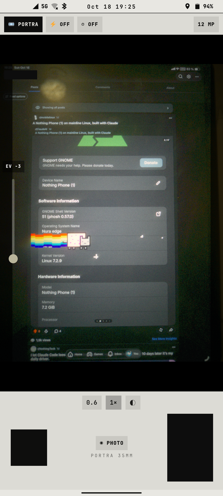

# notreal.cam

The camera app: main, ultra-wide and selfie lenses on the Nothing Phone (1), 12 MP photos, tap to focus, an EV slider, video, and a FILM mode with film-stock looks.

<p></p>

*Real phone: FILM mode (Portra 35 mm), EV −3, pointed at an iPad. The last-photo thumbnail and a username are blacked out.*

## Features

- **12 MP** photos: the preview pauses, libcamera grabs full-size frames and keeps the settled one (~3 s); **FAST** takes the preview frame instantly
- Lenses: 0.6× ultra-wide (S5KJN1), 1× main (IMX766), selfie (IMX471)
- Tap the preview to focus (drives `afd`, see [spacewar-fixes](../../spacewar-fixes/README.md#autofocus))
- EV slider on the left edge, shutter bottom-left (left-handed)
- VIDEO mode (x264), FILM mode (Portra / C200 looks with a date stamp)
- Photos go to `~/Pictures/Camera`, which is notreal.gallery's CAMERA tab
- Double-press the power button to open it, also from the lock screen ([shell/crt](../../shell/crt))

## Run

```sh
cp -r apps/notreal.cam ~/camera    # the code expects to live here
~/camera/nrcamera
```

Needs Python 3, PyGObject, GTK 4, libadwaita and the [theme](../../shell/theme) module on `PYTHONPATH` (or `notareal_theme.py` symlinked into `~/.local/lib/python3.*/site-packages/`).

## Needs

libcamera with the patches in `spacewar-fixes/libcamera`, PipeWire, GStreamer (`gtk4paintablesink`, `x264enc`)
