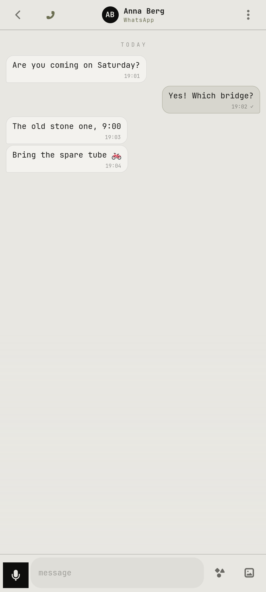

# notreal.chat

WhatsApp, Messenger, Instagram and Google Voice through your own Matrix bridges, plus SMS, in one app.

<p> </p>

## Features

- Filter chips per network; swipe left to archive, right to mark read/unread
- Reply by swiping a bubble, long-press to react, copy or delete
- Photos, GIFs (GIPHY), voice messages, locations (open in notreal.maps)
- SMS through ModemManager in the same list
- Group chats with sender names; never auto-joins invites
- `--service` keeps it in the background for notifications
- WhatsApp calls through WhatsApp Web in a lean Chromium window

## Run

```sh
cp -r apps/notreal.chat ~/chat    # the code expects to live here
~/chat/notarealchat
```

Needs Python 3, PyGObject, GTK 4, libadwaita and the [theme](../../shell/theme) module on `PYTHONPATH` (or `notareal_theme.py` symlinked into `~/.local/lib/python3.*/site-packages/`).

## Needs

your own Matrix server + mautrix bridges (see [pc/matrix](../../pc/matrix) and [docs/pc-link.md](../../docs/pc-link.md)), ModemManager for SMS

## Configure

`~/.config/notreal/pc.json` → `matrix`: your server's URL
