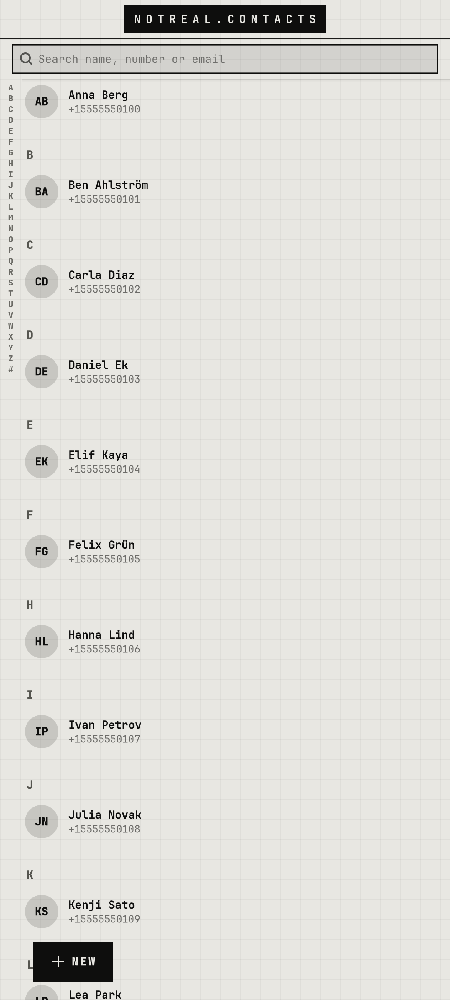

# notreal.contacts

Google contacts with a fast list and a big-step new-contact flow.

<p></p>

## Features

- A–Z list with a letter scrubber on the left edge
- CALL / SMS / WHATSAPP / MAIL on every contact (to notreal.phone, notreal.chat, notreal.mail)
- New contact in full-screen steps: NAME → PHONE → EMAIL
- Opens instantly from a cache, then refreshes from Evolution

## Run

```sh
cp -r apps/notreal.contacts ~/contacts    # the code expects to live here
~/contacts/nrcontacts
```

Needs Python 3, PyGObject, GTK 4, libadwaita and the [theme](../../shell/theme) module on `PYTHONPATH` (or `notareal_theme.py` symlinked into `~/.local/lib/python3.*/site-packages/`).

## Needs

evolution-data-server with a Google account (GNOME Online Accounts)
