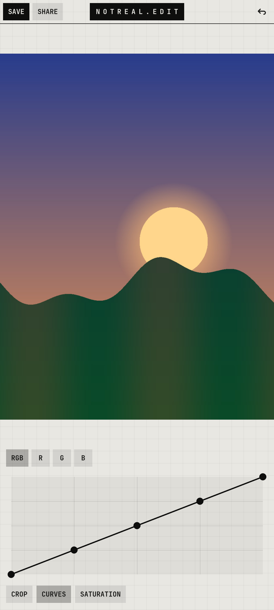

# notreal.edit

A small photo editor: crop, curves, saturation.

<p></p>

## Features

- Live preview on a downscaled copy; SAVE renders the full image in the background
- Saves `<name>_edit.jpg` next to the original, never overwrites it
- RGB and per-channel curves
- SHARE straight to a chat or a mail

## Run

```sh
cp -r apps/notreal.edit ~/edit    # the code expects to live here
~/edit/nredit
```

Needs Python 3, PyGObject, GTK 4, libadwaita and the [theme](../../shell/theme) module on `PYTHONPATH` (or `notareal_theme.py` symlinked into `~/.local/lib/python3.*/site-packages/`).

## Needs

GTK 4, GdkPixbuf
