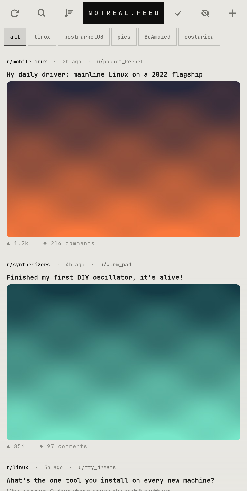

# notreal.feed

A reader for Reddit, through a self-hosted Redlib on your PC.

<p></p>

> Not affiliated with Reddit. The screenshot uses made-up posts.

## Features

- Your picked subreddits as one feed, chips to jump to one
- Images, galleries and full-length videos (remuxed to MP4 on the PC)
- Threaded comments, fold by tapping a header
- Search, subreddit browser, profiles
- Seen posts stay hidden for a few days

## Run

```sh
cp -r apps/notreal.feed ~/reddit    # the code expects to live here
~/reddit/notarealreddit
```

Needs Python 3, PyGObject, GTK 4, libadwaita and the [theme](../../shell/theme) module on `PYTHONPATH` (or `notareal_theme.py` symlinked into `~/.local/lib/python3.*/site-packages/`).

## Needs

[Redlib](https://github.com/redlib-org/redlib) + the feed API on your PC (see [pc/feed](../../pc/feed))

## Configure

`~/.config/notreal/pc.json` → `host`
