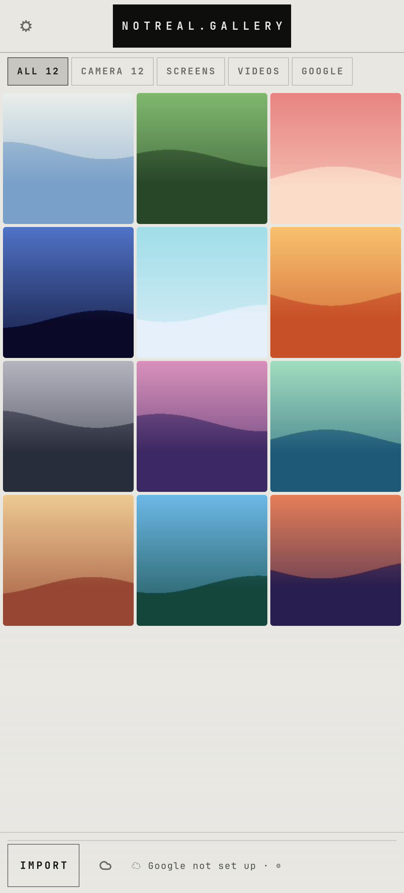

# notreal.gallery

Photos and videos, backed up to and imported from Google Photos.

<p></p>

## Features

- Grid with ALL / CAMERA / SCREENS / VIDEOS / GOOGLE tabs
- Viewer: swipe for next/previous, swipe down to close, pinch or double-tap to zoom
- EDIT (notreal.edit) and SHARE (notreal.share)
- `galleryd` backs up new photos to Google Photos on Wi-Fi; IMPORT opens Google's Photos Picker

## Run

```sh
cp -r apps/notreal.gallery ~/gallery    # the code expects to live here
~/gallery/gallery
```

Needs Python 3, PyGObject, GTK 4, libadwaita and the [theme](../../shell/theme) module on `PYTHONPATH` (or `notareal_theme.py` symlinked into `~/.local/lib/python3.*/site-packages/`).

## Needs

GStreamer for videos; for Google Photos your own OAuth client (see [GOOGLE-SETUP.md](GOOGLE-SETUP.md))
