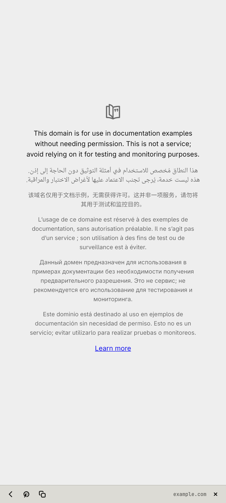

# notreal.link

A light web viewer for links opened from chat and mail.

<p></p>

## Features

- Opens fast in one small WebKit process instead of a whole browser
- Bar at the bottom with the buttons on the left: back, open in the full browser, copy link
- Later links open as more windows of the same app (D-Bus)

## Run

```sh
cp -r apps/notreal.link ~/link    # the code expects to live here
~/link/nrlink
```

Needs Python 3, PyGObject, GTK 4, libadwaita and the [theme](../../shell/theme) module on `PYTHONPATH` (or `notareal_theme.py` symlinked into `~/.local/lib/python3.*/site-packages/`).

## Needs

WebKitGTK 6
