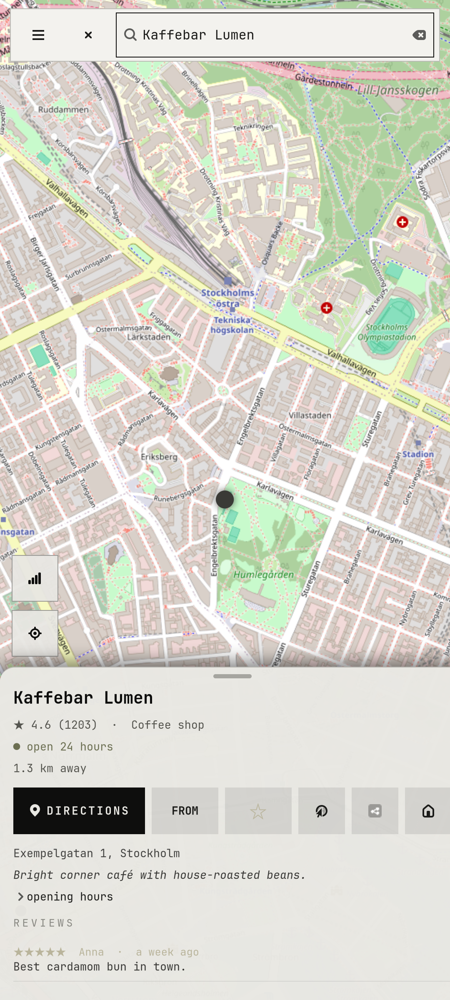
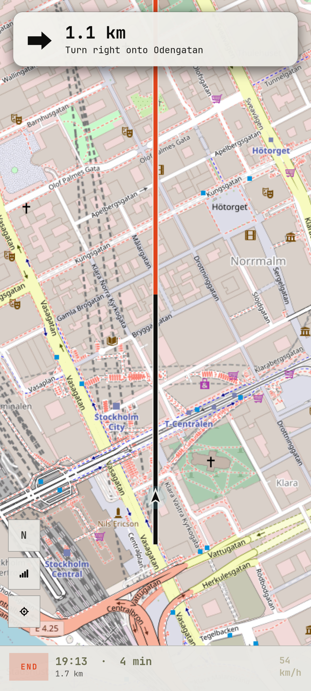

# notreal.maps

Google maps, places and traffic-aware routes with offline voice navigation.

<p>  </p>

> Screenshots use OpenStreetMap tiles (© OpenStreetMap contributors) and a made-up café; the app itself uses Google's tiles.

## Features

- Google Map Tiles (own night style), Places (New) and Routes API with live traffic
- Turn-by-turn with an offline voice (piper), driving, two-wheeler, bike, walking and transit
- Set a manual start when GPS has no fix
- Saved places, with Google Takeout import
- Keeps the phone awake while navigating

## Run

```sh
cp -r apps/notreal.maps ~/maps    # the code expects to live here
~/maps/notarealmaps
```

Needs Python 3, PyGObject, GTK 4, libadwaita and the [theme](../../shell/theme) module on `PYTHONPATH` (or `notareal_theme.py` symlinked into `~/.local/lib/python3.*/site-packages/`).

## Needs

libshumate, GeoClue, piper; **your own Google Maps Platform API key**

## Configure

the app asks for your Google Maps Platform API key on first start and keeps it in the keyring (or set `NOTAREAL_MAPS_KEY`). Enable Map Tiles, Places (New) and Routes for it
