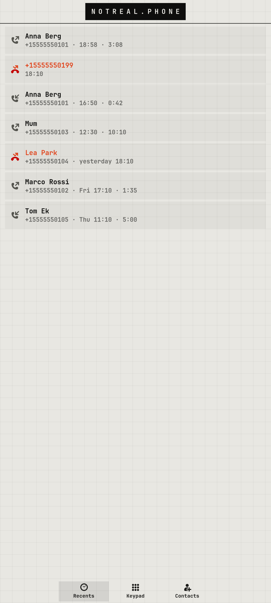

# notreal.phone

Dialer, recent calls and the in-call screen, on top of GNOME Calls.

<p></p>

## Features

- GNOME Calls still does the actual call work (modem, call audio), so calls keep working exactly as they did
- Recents with contact names, missed calls in red
- Keypad with DTMF during calls, mute and speaker via callaudiod
- `--service` (autostart) brings the call screen up for every incoming call

## Run

```sh
cp -r apps/notreal.phone ~/calls    # the code expects to live here
~/calls/nrcalls
```

Needs Python 3, PyGObject, GTK 4, libadwaita and the [theme](../../shell/theme) module on `PYTHONPATH` (or `notareal_theme.py` symlinked into `~/.local/lib/python3.*/site-packages/`).

## Needs

GNOME Calls, callaudiod; for the Nothing Phone (1) earpiece the call fixes in [spacewar-fixes](../../spacewar-fixes)
