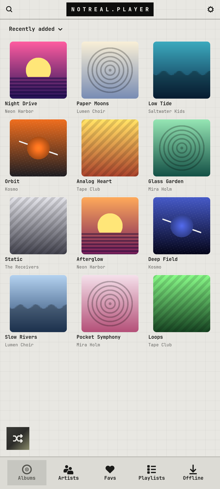
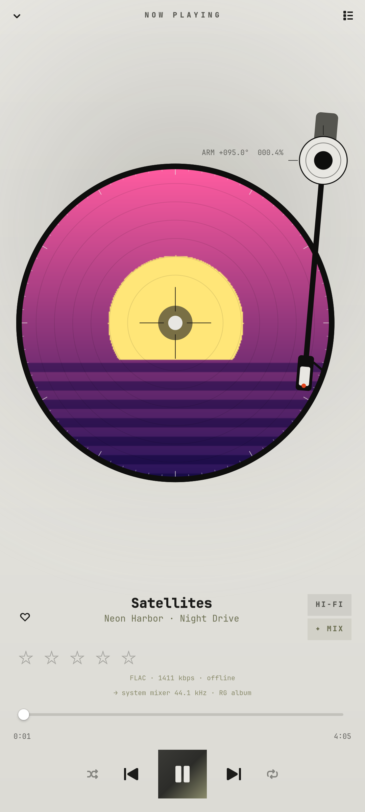
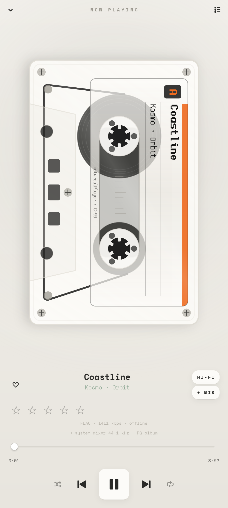

# notreal.player

A Navidrome music client with a spinning vinyl or a cassette (Settings › Look, or long-press the record to flip).

<p>  </p>

## Features

- Vinyl with a working tonearm, or a cassette with moving reels
- Animated album covers (from `cover.webp`, converted on the PC by [pc/music/spin_anim.py](../../pc/music))
- **HI-FI**: bit-perfect output straight to a USB DAC through ALSA
- Favourites kept offline automatically; pin albums for offline
- 1–5 star ratings, smart mixes (similar songs), crossfade, ReplayGain, equaliser
- MPRIS media controls (lock screen, overview widget)

## Install (any Linux)

The player works on its own: no notrealOS phone needed, just a [Navidrome](https://www.navidrome.org)
server with your music. It runs on Linux phones (postmarketOS, Mobian, ...) and desktops alike, and
carries all six themes with it (`theme/`).

```sh
git clone https://github.com/notrealOS/NotrealOS.git
cd NotrealOS/apps/notreal.player
./install.sh                # app menu entry, icon, `notreal-player` command, theme fonts
```

No root needed; everything goes to `~/.local`. If GTK 4, libadwaita (1.6+) or GStreamer is
missing, the installer prints the packages for Alpine/postmarketOS, Debian/Ubuntu, Fedora and Arch.
`./install.sh --no-fonts` skips the font download, `./install.sh --uninstall` removes it
(settings and offline songs stay in `~/.config/spin` and `~/.local/share/spin`).

Open it, sign in with your Navidrome address, and pick a theme in **Settings › Look**.

On the notrealOS phone itself the app lives in `~/spin` and uses the phone-wide theme instead,
plus the DAP mode button.

## Needs

a Navidrome server (see [pc/music](../../pc/music)); optional: the animated-cover server in `server/`, ImageMagick for smaller thumbnails

## Configure

sign in to your Navidrome server inside the app; `~/.config/notreal/pc.json` → `host` gives the default address
