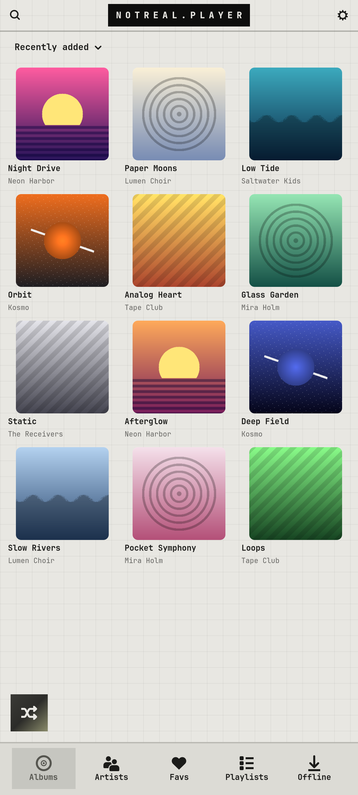
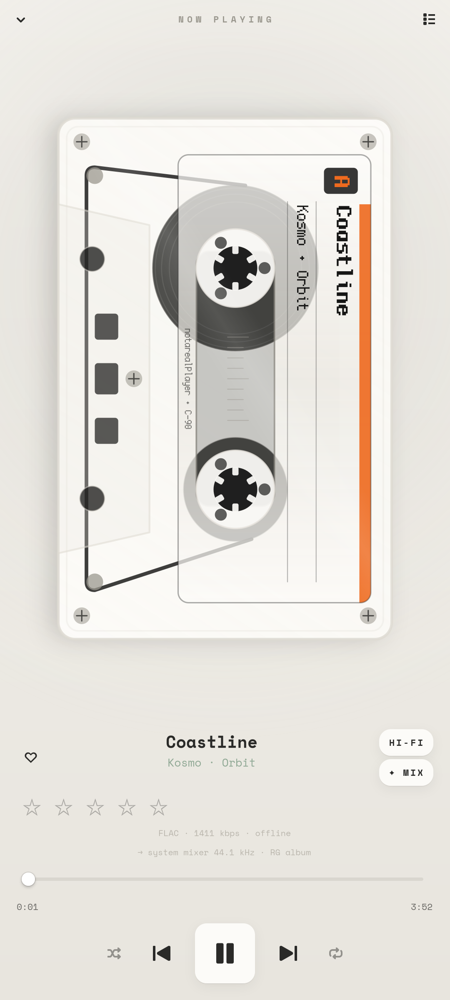

# notreal.player

A Navidrome music client with a spinning vinyl or a cassette (Settings › Look, or long-press the record to flip).

<p>  </p>

## Features

- Vinyl with a working tonearm, or a cassette with moving reels
- Animated album covers (from `cover.webp`, converted on the PC by [pc/music/spin_anim.py](../../pc/music))
- **HI-FI**: bit-perfect output straight to a USB DAC through ALSA
- Favourites kept offline automatically; pin albums for offline
- 1–5 star ratings, smart mixes (similar songs), crossfade, ReplayGain, equaliser
- MPRIS media controls (lock screen, overview widget)

## Run

```sh
cp -r apps/notreal.player ~/spin    # the code expects to live here
python3 ~/spin/spin.py
```

Needs Python 3, PyGObject, GTK 4, libadwaita and the [theme](../../shell/theme) module on `PYTHONPATH` (or `notareal_theme.py` symlinked into `~/.local/lib/python3.*/site-packages/`).

## Needs

a [Navidrome](https://www.navidrome.org) server (see [pc/music](../../pc/music)), GStreamer

## Configure

sign in to your Navidrome server inside the app; `~/.config/notreal/pc.json` → `host` gives the default address
