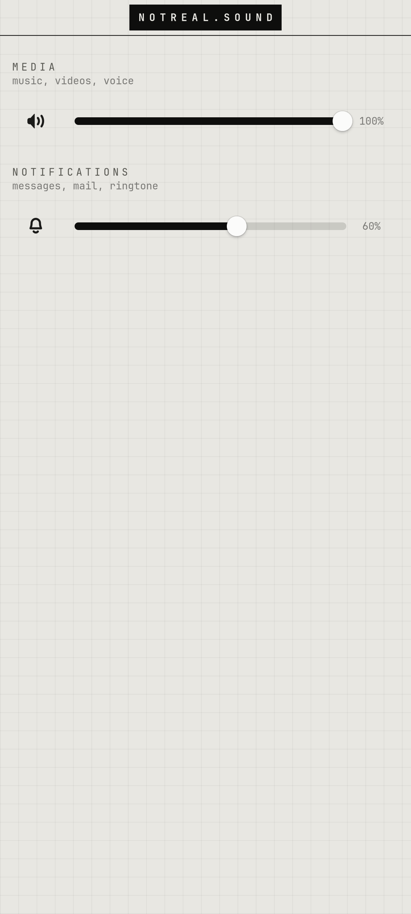

# notreal.sound

Separate volumes for media and notifications.

<p></p>

## Features

- MEDIA = the speaker/headphone volume (same as the volume keys)
- NOTIFICATIONS = its own level, applied by `nrvolumed` to notification sounds
- Mute and test buttons on the left

## Run

```sh
cp -r apps/notreal.sound ~/nrvolume    # the code expects to live here
~/nrvolume/nrvolume
```

Needs Python 3, PyGObject, GTK 4, libadwaita and the [theme](../../shell/theme) module on `PYTHONPATH` (or `notareal_theme.py` symlinked into `~/.local/lib/python3.*/site-packages/`).

## Needs

PulseAudio (or PipeWire-Pulse)
