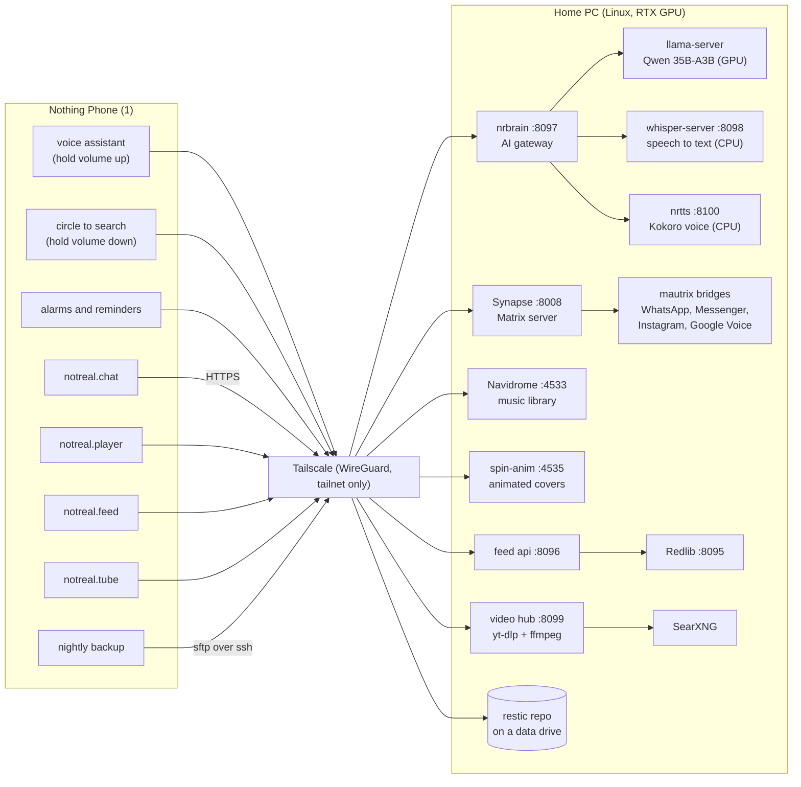

# How the phone and the PC work together

The phone does everything it can on its own. The heavy work (a 35-billion-parameter language
model, natural speech, chat bridges, a music library, a Reddit proxy, backups) runs on a home PC.
The two are joined by [Tailscale](https://tailscale.com), a private network that works the same
over Wi-Fi, mobile data or abroad.

No port on the PC is open to the internet or even to the home network: every service listens on
`127.0.0.1` only, and Tailscale forwards it to devices in your tailnet.



## What talks to what

| On the phone | PC service | Port | What it does |
| --- | --- | --- | --- |
| voice assistant, circle to search | `nrbrain` → `llama-server` | 8097 (`/v1/chat/completions`) | Answers questions and turns speech into actions with Qwen3.6 35B-A3B. Loaded on demand, unloaded after 10 idle minutes to give the VRAM back |
| voice assistant, voice typing | `nrbrain` → `whisper-server` | 8097 (`/inference`) | Speech to text, whisper *small* on the CPU (~1 s) |
| voice assistant, alarms, reminders | `nrbrain` → `nrtts` | 8097 (`/tts`) | Natural voice (Kokoro `af_heart`) |
| notreal.chat | Synapse + mautrix bridges | 443 → 8008 (HTTPS via `tailscale serve`) | Your own Matrix server; WhatsApp, Messenger, Instagram and Google Voice appear as Matrix rooms |
| notreal.player | Navidrome | 4533 | Music library (Subsonic API), bit-perfect streaming |
| notreal.player | `spin_anim.py` | 4535 | Turns animated `cover.webp` album art into small looping MP4s the phone can decode cheaply |
| notreal.feed | Redlib + `api.py` | 8095, 8096 | Redlib reads Reddit; `api.py` turns its pages into compact JSON and resizes images for the phone |
| notreal.tube | `hub.py` + SearXNG | 8099 | Feed from channel RSS, search, streams remuxed to one MP4 by ffmpeg; on mobile data the phone runs the same hub itself |
| nightly backup | sshd | 22 | `restic` over sftp to a big data drive, only while charging on Wi-Fi |

### Everything still works without the PC

When the PC is off or unreachable, the phone falls back to its own, smaller tools:

- speech to text: whisper on the phone's CPU
- answers: Qwen3 1.7B on the phone (llama.cpp, CPU)
- voice: piper (`en_US-amy-medium`)

Chat, music, feed and backups wait until the PC is back. Songs you marked as favourites are kept
on the phone, so they still play offline.

## Set it up

1. **Tailscale on both machines.** Install it on the PC and on the phone (`apk add tailscale` on
   postmarketOS) and log both into the same tailnet. Turn on MagicDNS and HTTPS certificates in the
   admin console if you want the Matrix server on `https://<pc>.<tailnet>.ts.net`.
2. **Tell the phone where the PC is**, in `~/.config/notreal/pc.json`:
   ```json
   { "host": "100.x.y.z", "matrix": "https://your-pc.your-tailnet.ts.net" }
   ```
   (`tailscale ip -4` on the PC prints the address.)
3. **SSH key from the phone to the PC** (for backups and for building packages on the PC):
   ```sh
   ssh-keygen -t ed25519            # on the phone
   ssh-copy-id you@100.x.y.z
   ```
4. **Start the PC services you want.** See [`pc/README.md`](../pc/README.md).
5. **Expose them to the tailnet only**:
   ```sh
   for p in 4533 4535 8095 8096; do tailscale serve --bg --tcp $p tcp://127.0.0.1:$p; done
   tailscale serve --bg https+insecure://127.0.0.1:8008   # Matrix on https://<pc>.<tailnet>.ts.net
   ```
   `nrbrain` is the exception: it binds to the PC's Tailscale IP itself (`NRBRAIN_HOST` in its
   systemd unit), so it's never reachable from anywhere else either.

## Why it's built this way

- **One gateway for AI.** The phone only knows `nrbrain`. It decides what runs where, frees GPU
  memory from other programs (ComfyUI) before loading the model, and unloads it when idle.
- **Speech runs on the CPU** so the whole 16 GB of the GPU stays free for the language model.
- **The phone never decodes what it doesn't have to.** Covers are converted to small MP4s, feed
  images are resized on the PC; the phone's battery and RAM go to the UI.
- **Nothing is public.** No port forwarding, no cloud relay of your messages: the Matrix server and
  its bridges are yours, reachable only from your own devices.
