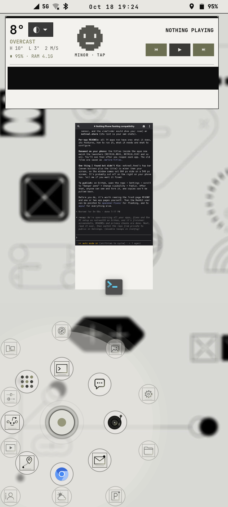
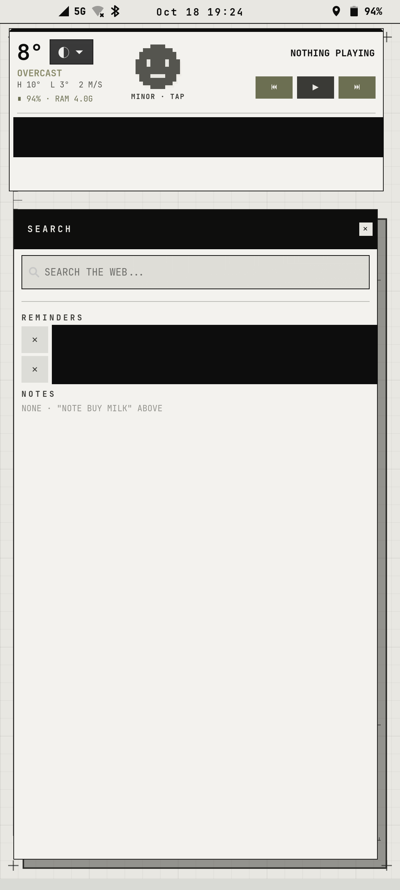
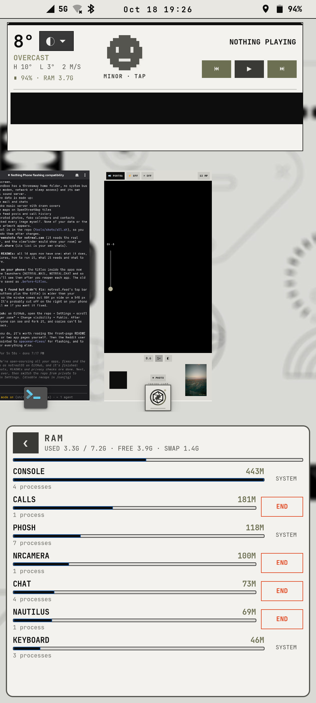

# Shell

<p>



</p>

Everything that replaces or sits on top of the Phosh shell. Each part runs as a small user
daemon started from `~/.config/autostart`, and most have a `*-loop` wrapper that restarts them.

The code expects to live in your home folder under its original short name (see the table), so
copy or symlink each folder there:

```sh
ln -s ~/notrealOS/shell/joystick ~/arc     # and so on, per the table
```

| Repo folder | Install as | What it is |
| --- | --- | --- |
| [`phantomshell/`](phantomshell) | `~/.local/share/phantomshell` | **notarealShell**: the wallpaper layer and the SEARCH pop-up with **reminders** and **notes** ([details](phantomshell/README.md)) |
| [`overview-widget/`](overview-widget) | `~/overview-widget` | The widget over the Phosh overview: weather, theme picker, RAM, health face, now playing, agenda ([details](overview-widget/README.md)) |
| [`joystick/`](joystick) | `~/arc` | The **joystick launcher** that replaces the app grid: hold it and your most-used apps fan out under your thumb ([details](joystick/README.md)) |
| [`keyboard/`](keyboard) | `~/swipe` | Swipe keyboard (glide typing) with suggestions, user words, emoji, 🎤 voice typing via whisper, and 📋 **clipboard history** (your last 6 copies, tap to paste; kept in memory only, password-manager secrets skipped). `swipe-im.c` is the Wayland input-method helper |
| [`gestures/`](gestures) | `~/gestures` | Bottom-edge swipe to switch apps; three-finger swipe down quits a Moonlight stream |
| [`crt/`](crt) | `~/crt` | CRT power-off/on animation when the screen sleeps and wakes; double-press power opens notreal.cam |
| [`rotated/`](rotated) | `~/rotated` | Auto-rotate that waits until you've really turned the phone (no flipping while lying down) |
| [`circle/`](circle) | `~/circle` | Circle to search: hold volume down, circle or tap any text on screen → call, open, map, copy, search, or ask the PC's AI |
| [`shadewatch/`](shadewatch) | `~/shadewatch` | Debug helper for the notification shade state |
| [`theme/`](theme) | `~/theme` | Themes for everything, see its README |

## Dependencies (postmarketOS / Alpine)

```sh
sudo apk add py3-gobject3 gtk4.0 gtk4-layer-shell libadwaita wlrctl lisgd tesseract-ocr wtype \
    wayland-dev libxkbcommon-dev gcc musl-dev
```

## Build the C helpers

```sh
cd keyboard && gcc -O2 -Wall -o swipe-im swipe-im.c *-protocol.c -lwayland-client -lxkbcommon
cd overview-widget && gcc -O2 -Wall -o toplevel-watch toplevel-watch.c \
    wlr-foreign-toplevel-management-unstable-v1.c $(pkg-config --cflags --libs wayland-client)
```

## Keyboard dictionary

```sh
keyboard/get-dict.sh    # downloads FrequencyWords (CC BY-SA 4.0) and builds dict/<lang>.tsv
```

Words you add with ＋ are kept in `~/.local/share/swipekbd`, outside this folder.

## Launchers

`.desktop` files contain `@HOME@` where your home folder goes:

```sh
sed "s|@HOME@|$HOME|g" keyboard/sm.puri.OSK0.desktop > ~/.local/share/applications/sm.puri.OSK0.desktop
```

## Talking to each other

The parts talk over the session D-Bus: `org.notarealinux.PhantomShell`, `.OverviewWidget`, `.Glyph`
and so on. The circle-to-search ASK, the voice assistant and the alarms reach the PC through
`~/.config/notreal/pc.json` (see [docs/pc-link.md](../docs/pc-link.md)).
